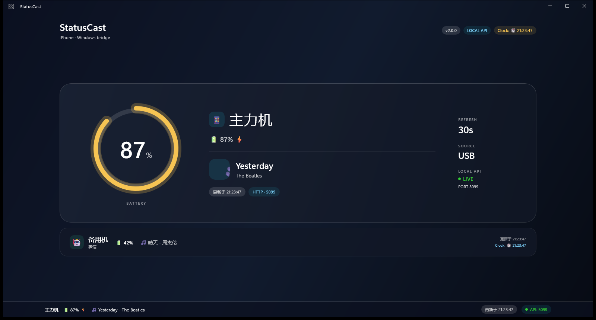
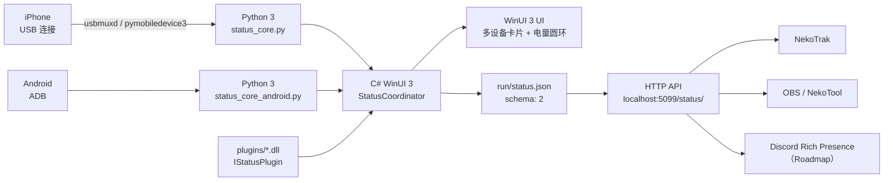

<div align="center">

# StatusCast

**把 iPhone / Android 的电量与状态，广播到 Windows 桌面和第三方展示端。**

[](https://www.microsoft.com/windows)
[](https://www.python.org/)
[](https://dotnet.microsoft.com/)
[](http://localhost:5099/status/)
[](https://github.com/ganmayou2333/StatusCast/releases)
[](LICENSE)

</div>

---

## 项目简介

StatusCast 是一个运行在 Windows 上的 **桌面状态聚合平台**。

它通过 **USB** 读取 iPhone、通过 **ADB** 读取 Android 的电量、充电状态、机型和媒体状态，由 **WinUI 3** 桌面应用展示，并对外提供本地 **HTTP API**，供 NekoTrak、OBS、未来的 Discord Rich Presence 或其他客户端读取。

v2.0 加入了多设备、自定义别名和动态插件系统：

- 一个窗口同时展示 iPhone 与 Android；
- `config.json` 把 `iPhone15,3` 映射成“主力机”；
- `plugins/*.dll` 可以动态扩展状态来源。

核心原则：

- 一套聚合中枢，避免每个客户端反复打开 USB / ADB；
- UI、采集和插件解耦；
- 第三方展示端只读 v2 JSON，不直接接触设备。

## 特性亮点

- 🔋 **iPhone USB + Android ADB**  
  iPhone 走 `pymobiledevice3`，Android 走 ADB，不需要 root。

- 🎨 **多设备 WinUI 3 界面**  
  MVVM + `x:Bind` + Mica 材质 + 动态电量圆环；Android 作为第二张设备卡片展示。

- 🌐 **v2 本地 HTTP API**  
  `http://localhost:5099/status/` 返回 `schema: 2`，包含 `devices` 和 `plugins` 数组。

- 🏷️ **自定义别名**  
  `config.json` 把原始机型映射成“主力机 / 备用机”等显示名。

- 🔌 **动态插件系统**  
  `StatusCast.Core` 定义 `IStatusPlugin`，从 `plugins/*.dll` 加载并启用。

- 🛡️ **单一数据源**  
  `StatusCoordinator` 并行采集后原子写入 `run/status.json`；其他消费者读取快照或 API。



> 截图使用演示数据；真实数据由 USB / ADB 连接的设备提供。

## 架构图



数据流：

```text
iPhone --USB--> status_core.py ─┐
Android --ADB--> status_core_android.py ─┤
plugins/*.dll --> StatusCoordinator ──────┤
                                           ├─ WinUI 3 多设备 UI
                                           ├─ run/status.json (schema 2)
                                           └─ HTTP API :5099
```

## 快速开始

### 1. 环境要求

| 项目 | 要求 |
| --- | --- |
| 操作系统 | Windows 10 1809+ / Windows 11 |
| Python | Python 3.10+ |
| .NET | .NET 10 SDK（项目当前目标 `net10.0-windows10.0.26100.0`） |
| UI | Windows App SDK 2.5.x（NuGet 自动还原） |
| Apple 驱动 | iTunes 或 Apple Devices，确保 `Apple Mobile Device Service` 正常运行 |
| Android 工具 | Android Platform Tools，`adb` 已加入 `PATH`（仅 Android 设备需要） |
| 设备 | iPhone 用可传输数据的 USB 线；Android 开启 USB 调试并授权电脑 |

> 如果希望使用 .NET 8，请同时修改 `StatusCast.Gui.csproj` 的 `TargetFramework` 和 SDK 版本；当前仓库以 .NET 10 构建。

### 2. 配置 Python 环境

```powershell
git clone https://github.com/ganmayou2333/StatusCast.git
cd StatusCast

py -3 -m venv .venv
.\.venv\Scripts\python.exe -m pip install --upgrade pip
.\.venv\Scripts\python.exe -m pip install -r requirements.txt
```

验证 Python 采集：

```powershell
.\.venv\Scripts\python.exe status_core.py
```

预期输出：

```text
STATUS:BATTERY:97|CHARGING:true|MEDIA:NA|NA|unknown|MODEL:iPhone14,3
```

验证 Android 采集：

```powershell
adb devices
.\.venv\Scripts\python.exe status_core_android.py
```

预期输出：

```text
STATUS:BATTERY:42|CHARGING:false|MEDIA:晴天|周杰伦|playing|MODEL:Pixel 7|APP:com.tencent.mm|APPNAME:微信
```

### 3. 配置别名与插件

编辑根目录 `config.json`：

```json
{
  "Aliases": {
    "iPhone15,3": "主力机",
    "Pixel 7": "备用机"
  },
  "EnabledPlugins": ["Clock"]
}
```

- `Aliases`：把原始机型映射成 UI 显示名；
- `EnabledPlugins`：只加载这些名字的插件；留空数组即可关闭插件。

构建示例插件：

```powershell
.\scripts\build_plugins.ps1
```

插件 DLL 会输出到 `plugins\ClockPlugin.dll`，重启 WinUI 后生效。

### 4. 编译并运行 WinUI 3

```powershell
dotnet build .\gui\StatusCast.Gui\StatusCast.Gui.csproj -c Debug -p:Platform=x64
dotnet run --project .\gui\StatusCast.Gui\StatusCast.Gui.csproj -c Debug -p:Platform=x64
```

也可以使用包装脚本：

```powershell
powershell -NoProfile -ExecutionPolicy Bypass -File .\scripts\run_gui.ps1
```

启动后：

- 主卡片显示主设备（iPhone 优先）的机型、电量圆环和状态；
- Android 作为第二张设备卡片显示；
- 顶部胶囊显示已启用插件的状态；
- 每 30 秒自动刷新；
- 状态同时写入 `run/status.json`（schema 2）。

## 使用 HTTP API

WinUI 应用启动后，HTTP 服务自动监听：

```text
http://localhost:5099/status/
```

请求示例：

```powershell
Invoke-RestMethod http://localhost:5099/status/ | ConvertTo-Json -Depth 4
```

返回示例：

```json
{
  "schema": 2,
  "generatedAt": 1792848052,
  "primaryDeviceId": "iphone",
  "devices": [
    {
      "id": "iphone",
      "platform": "ios",
      "model": "iPhone15,3",
      "displayName": "主力机",
      "batteryLevel": 87,
      "isCharging": true,
      "mediaTitle": "Yesterday",
      "mediaArtist": "The Beatles",
      "mediaState": "playing",
      "foregroundApp": null,
      "foregroundAppName": null,
      "updatedAt": 1792848052,
      "error": null,
      "text": "📱 主力机 | 🔋 87% ⚡ | 🎵 Yesterday - The Beatles"
    },
    {
      "id": "android",
      "platform": "android",
      "model": "Pixel 7",
      "displayName": "备用机",
      "batteryLevel": 42,
      "isCharging": false,
      "mediaTitle": "晴天",
      "mediaArtist": "周杰伦",
      "mediaState": "playing",
      "foregroundApp": "com.tencent.mm",
      "foregroundAppName": "微信",
      "updatedAt": 1792848052,
      "error": null,
      "text": "🤖 备用机 | 🔋 42% | 🎵 晴天 - 周杰伦"
    }
  ],
  "plugins": [
    {
      "name": "Clock",
      "status": "🕐 21:23:47",
      "error": null
    }
  ],
  "battery": {
    "level": 87,
    "isCharging": true,
    "updatedAt": 1792848052,
    "error": null
  },
  "media": {
    "title": "Yesterday",
    "artist": "The Beatles",
    "playbackState": "playing"
  },
  "errors": [],
  "text": "📱 主力机 | 🔋 87% ⚡ | 🎵 Yesterday - The Beatles"
}
```

说明：

- `schema: 2`；`devices` 是完整设备数组，`plugins` 是插件状态；
- 为兼容 NekoTool 等旧客户端，顶层仍保留 `battery`、`media`、`text`（取自主设备）；
- API 仅绑定 `localhost`，不暴露到局域网；
- 返回 `application/json; charset=utf-8`；
- 快照尚未生成时返回 `503`；
- 非 GET 请求返回 `405`；
- 未知路径返回 `404`；
- 端口被占用时应用不会崩溃，底部指示器会显示 `API: 未启动`。

## 纯命令行版本

不启动 WinUI 也可以直接在终端读取状态：

```powershell
.\.venv\Scripts\python.exe cli\statuscast.py
```

输出：

```text
📱 14 Pro Max | 🔋 87% ⚡ | 🎵 暂无播放
```

输出与 HTTP API 相同结构的 JSON：

```powershell
.\.venv\Scripts\python.exe cli\statuscast.py --json
```

每 30 秒刷新一次：

```powershell
.\.venv\Scripts\python.exe cli\statuscast.py --watch 30
```

说明：

- 仅依赖 Python + USB，不需要 WinUI 或 HTTP 服务；
- 没有检测到设备时退出码为 `1`，输出仍会保留友好提示；
- `--watch` 模式会持续运行，按 `Ctrl+C` 停止。

打包单文件 exe：

```powershell
.\scripts\build_cli.ps1
```

输出位于 `dist\statuscast-cli.exe`，可直接分发，不需要目标机器安装 Python。

## NekoTrak 接入

在 NekoTrak 的自定义文本框中填写：

```text
${(Invoke-RestMethod -Uri 'http://localhost:5099/status/' -UseBasicParsing).text}
```

显示效果类似：

```text
📱 13 Pro Max | 🔋 97% ⚡ | 🎵 暂无播放
```

也可以直接调用仓库中的脚本：

```text
{powershell.exe -NoProfile -ExecutionPolicy Bypass -File "G:\StatusCast\integrations\nekotrak\pull.ps1"}
```

使用前请确保 StatusCast WinUI 应用正在运行，否则 API 不可用。

## 项目结构

```text
StatusCast/
├─ status_core.py                  # iPhone USB 电量/机型采集
├─ status_core_android.py          # Android ADB 电量/机型/前台应用/媒体
├─ config.json                     # Aliases + EnabledPlugins
├─ config.toml                     # 旧版 daemon 配置（保留）
├─ cli/statuscast.py               # 纯命令行版本
├─ requirements.txt
├─ pyproject.toml
├─ core/                           # Python 核心/数据源
├─ adapters/                       # 适配器骨架
├─ gui/
│  ├─ StatusCast.Core/             # IStatusPlugin + PluginHost
│  └─ StatusCast.Gui/              # WinUI 3 桌面应用
│     ├─ Services/
│     │  ├─ StatusService.cs       # iPhone + Android 采集 + 共用 runner
│     │  ├─ StatusCoordinator.cs   # Task.WhenAll + v2 快照
│     │  ├─ StatusSnapshot.cs
│     │  ├─ StatusCastConfig.cs
│     │  └─ StatusServer.cs        # localhost:5099 HTTP API
│     ├─ ViewModels/MainViewModel.cs
│     └─ MainWindow.xaml           # 多设备卡片、电量圆环、插件胶囊
├─ plugins/
│  ├─ README.md
│  └─ ClockPlugin/                 # 示例插件源码
├─ integrations/nekotrak/pull.ps1
├─ scripts/
│  ├─ run_gui.ps1
│  ├─ build_plugins.ps1
│  ├─ run_daemon.ps1
│  ├─ install_task.ps1
│  └─ probe_ams.py
├─ tests/
│  ├─ manual/
│  └─ test_*.py
├─ legacy/get_status.ps1
├─ docs/
│  ├─ ble-ams-notes.md
│  └─ screenshots/
├─ .github/workflows/dotnet.yml
└─ run/                            # 运行时快照（不提交）
```

## 已知问题 / Roadmap

### 已完成

- [x] USB 读取 iPhone 电量、充电状态与机型
- [x] ADB 读取 Android 电量、机型、前台应用与媒体状态
- [x] iPhone + Android `Task.WhenAll` 并行采集
- [x] v2 多设备快照（`devices` 数组）
- [x] `config.json` 自定义别名
- [x] `IStatusPlugin` 动态插件系统 + Clock 示例
- [x] WinUI 3 多设备展示 + MVVM + Mica + 动态电量圆环
- [x] 纯命令行输出（文本 / JSON / watch 模式）
- [x] 本地 HTTP 广播服务 `http://localhost:5099/status/`
- [x] NekoTrak 文本接入

### 进行中 / 计划

- [ ] 解决 Realtek 蓝牙适配器的 BLE 配对认证问题  
      当前 AMS 订阅会返回 `Insufficient Authentication`，预计需要更换 Intel 蓝牙网卡后继续验证。
- [ ] 接入 Apple Media Service (AMS)，获取歌名、艺术家与播放状态
- [ ] 开发 Discord Rich Presence 适配器
- [ ] 增加 Web 面板与更多展示端
- [ ] 提供 MSIX 安装包与登录自启选项

## 常见问题

### 检测不到 iPhone

1. 使用支持数据传输的 USB 线；
2. 解锁 iPhone，并在弹窗中点击“信任此电脑”；
3. 确认 `Apple Mobile Device Service` 正在运行；
4. 重新插拔 USB，或重启 Apple 设备服务。

### 检测不到 Android

1. 安装 Android Platform Tools，确认 `adb devices` 能看到设备；
2. Android 打开开发者选项 → USB 调试，并在手机上允许此电脑；
3. 如果显示 `unauthorized`，重新插拔 USB 并在手机上确认授权；
4. 运行 `.\.venv\Scripts\python.exe status_core_android.py` 检查原始输出。

### 别名没有生效

`Aliases` 的 key 必须和采集输出里的原始 `MODEL` 完全一致，例如：

```json
"Aliases": {
  "iPhone15,3": "主力机",
  "Pixel 7": "备用机"
}
```

修改 `config.json` 后需要重启 StatusCast。

### 插件没有加载

- DLL 必须直接放在仓库根目录的 `plugins/` 下；
- `PluginName` 必须出现在 `EnabledPlugins` 数组里；
- 插件需要引用 `StatusCast.Core` 并实现 `IStatusPlugin`；
- 重启 WinUI，查看顶部插件胶囊或 `run/status.json` 的 `plugins` 数组。

### 页面显示“设备未连接”

先运行：

```powershell
.\.venv\Scripts\python.exe status_core.py
```

确认输出中不是 `BATTERY:NA`。

### HTTP API 启动失败

端口 `5099` 可能被占用。关闭占用端口的程序后重启 WinUI；应用会捕获异常并显示 `API: 未启动`，不会要求管理员权限。

## 版本与发布

- 当前版本：`v2.0.0`
- 发布页：[GitHub Releases](https://github.com/ganmayou2333/StatusCast/releases)
- 变更记录：[CHANGELOG.md](CHANGELOG.md)

## 贡献

欢迎提交 Issue 和 Pull Request。建议先创建 Issue 描述使用场景或问题，再提交改动。详见 [CONTRIBUTING.md](CONTRIBUTING.md)。

## 安全

安全问题请使用 GitHub 私有安全报告，不要直接开公开 Issue。详见 [SECURITY.md](SECURITY.md)。

## License

本项目基于 [MIT License](LICENSE) 开源。

## 致谢

- [pymobiledevice3](https://github.com/doronz88/pymobiledevice3)
- [Windows App SDK / WinUI 3](https://learn.microsoft.com/windows/apps/winui/)
- [bleak](https://github.com/hbldh/bleak)

---

<div align="center">

**StatusCast** · Bridge your iPhone status to Windows.

[](https://github.com/deepseek-ai/deepseek-harness)

</div>
