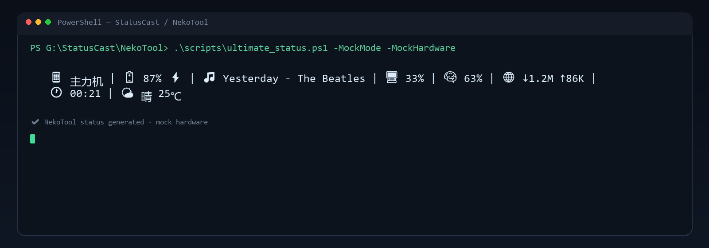

<div align="center">

# StatusCast

**A headless status server for the devices on your desk.**

Reads battery, charging and media state from an iPhone over USB and an Android
over ADB, probes consoles and NAS boxes on the LAN, samples BLE peripherals, and
publishes all of it as one JSON snapshot on `http://localhost:5099/status/`.
Also runs standalone on an ESP32-S3, with its own 128×64 OLED.

[](https://www.microsoft.com/windows)
[](https://dotnet.microsoft.com/)
[](http://localhost:5099/status/)
[](firmware/esp32/README.md)
[](LICENSE)

</div>

---

## 这是什么

**Windows 上的无界面设备状态采集引擎。** 它把桌面上散落的设备——iPhone、Android、
游戏主机、NAS、蓝牙耳机、心率带、本机的 NekoTrak——汇总成一份固定的 JSON，
通过 HTTP 交给你自己的聚合层（[NekoTool](https://github.com/ganmayou2333/NekoTool)）、
OBS 文本源、或者任何会发 GET 的东西。

- 每 30 秒一轮，原子写入 `run/status.json`；
- `http://localhost:5099/status/` 返回纯 JSON，`/health` 给守护脚本探活；
- 没有窗口、没有托盘图标、没有配置界面。它只做数据层。

同一份契约还有第二种形态：**跑在 ESP32-S3 上的独立固件**，不需要 PC 常开，
自己探测局域网主机和 BLE 外设，另加一块 128×64 单色屏做本机显示。两种形态的
`/status/` 字节级兼容，切换只需要改一个 URL。



> 上图是 NekoTool 侧消费 `/status/` 之后的输出（`-MockMode` 演示数据）。
> StatusCast 本身不画界面。

## 快速开始

需要 Windows 10 1809+、.NET 10 SDK（仅构建时需要）、Python 3.10+。

```powershell
git clone https://github.com/ganmayou2333/StatusCast.git
cd StatusCast

py -3 -m venv .venv
.\.venv\Scripts\python.exe -m pip install -r requirements.txt

dotnet build .\src\StatusCast.Daemon\StatusCast.Daemon.csproj -c Debug
dotnet run  --project .\src\StatusCast.Daemon\StatusCast.Daemon.csproj -c Debug
```

起来之后自检一下：

```powershell
curl.exe http://localhost:5099/health
# {"ok":true,"deviceCount":3,"generatedAt":1794031457,"schema":3}
```

`deviceCount` 大于 0 就说明一轮采集已经落盘。真实启动日志长这样：

```text
[SYSTEM] StatusCast Core v3.4.0 启动
[SYSTEM] 纯后台采集引擎 · 轮询间隔 30 秒
[API] 监听 http://localhost:5099/status/
[API] 健康检查 http://localhost:5099/health
[USB] 等待 iPhone 连接...
[ADB] 等待 Android 连接...
[IOS] 未检测到 iPhone：Device is not connected.
[ANDROID] ADB not found. Install Android Platform Tools and add adb to PATH.
[WINDOWS] NekoTrak 1.2.0 | 🔋 未知 | 🎵 暂无播放
[SNAPSHOT] run/status.json 已更新 · 1794031457
```

缺什么只会让对应设备那一条降级，其余照常采集。完整的安装、静默运行与 NekoTool
接线见 [安装与运行](docs/guide/install.md)。

## 采集什么

| 来源 | 怎么读 | 可选的额外对象 |
| --- | --- | --- |
| iPhone | USB（`pymobiledevice3` + usbmuxd） | `transport` |
| Android | ADB（USB 或无线调试） | `transport` |
| 游戏主机 / NAS | ARP → ICMP ping → TCP 端口，带迟滞 | `console`、`transport` |
| Mac / Linux 节点 | SSH（Windows 自带 OpenSSH 客户端） | `node`、`transport` |
| 蓝牙耳机 / 心率带 | BLE GATT（`0x180F` 电量、`0x180D` 心率） | `ble`、`transport` |
| NekoTrak | 读它自己的明文日志与 Steam 库索引 | `nekotrak`、`transport` |

除 iPhone / NekoTrak 外都需要在 `config.json` 里声明；全部键都是可选的，文件不存在
也能跑。细节见 [设备采集配置](docs/guide/collectors.md)。

## 架构

```text
iPhone --USB--> collectors/iphone_collector.py ─┐
Android --ADB--> collectors/android_collector.py ─┤
主机/BLE/NekoTrak --> collectors/*.py ─────────────┤
                                                   ▼
                                  status_core.py（调度 + JSON 合并）
                                                   │  采集层 JSON
                                                   ▼
                                       StatusCast.Daemon
                                       ├─ StatusService（解析）
                                       ├─ StatusCoordinator（别名 + 快照）
                                       ├─ run/status.json（schema 3）
                                       └─ HTTP API :5099
                                                   │
                                                   ▼
                                    NekoTool / OBS / 任何 HTTP 客户端
```

采集层是插件式的：继承 `BaseCollector`、实现 `get_data()`、在 `build_collectors()`
里注册即可。见[写自己的采集器](docs/guide/collectors.md#写自己的采集器)。

> 仓库不再包含 WinUI 3 / Windows App SDK、`IStatusPlugin`、动态插件 DLL。

## 文档

| 我想…… | 看这里 |
| --- | --- |
| 装起来、让它开机自启、接进 NekoTool | [安装与运行](docs/guide/install.md) |
| 配置主机 / SSH 节点 / BLE / Android 无线调试 | [设备采集配置](docs/guide/collectors.md) |
| 解析 `/status/` 的 JSON、看 13 键与加法对象 | [HTTP API 与契约](docs/guide/http-api.md) |
| 用 ESP32 的控制接口（重启 / 改配置 / 换令牌） | [ESP32 控制面](docs/guide/control-api.md) |
| 烧录 ESP32 固件、接 OLED | [固件文档](firmware/esp32/README.md) |
| 排查「为什么它不工作」 | [排障 FAQ](docs/guide/faq.md) |

词表见 [GLOSSARY.md](GLOSSARY.md)；影响架构的决定记在 [docs/adr/](docs/adr/)。

## 两种部署形态

|  | PC daemon | ESP32-S3 固件 |
| --- | --- | --- |
| 需要常开的 PC | 是 | 否 |
| iPhone / Android / NekoTrak | 直连采集 | 从 PC 快照转发 |
| 局域网主机 | ARP / ping / TCP | ping / TCP（**无 ARP**） |
| BLE | bleak / WinRT | NimBLE |
| 屏幕 | 无 | SSD1315 128×64 |
| 监听 | `localhost:5099` | `0.0.0.0:5099` |
| 鉴权 | 无 | 只读面无；`/control/*` 需令牌 |

## 开发

```powershell
# Python 采集层：全离线、零真机
.\.venv\Scripts\python.exe -m unittest discover -s tests -t .

# C# daemon
dotnet run --project .\tests-csharp\StatusCast.Daemon.Tests\StatusCast.Daemon.Tests.csproj -c Release

# 固件（无板可跑）
.\firmware\esp32\tools\host-test.ps1
```

`schema/status-contract.json` 是 schema-3 字段的**唯一事实源**。Python、C#、固件三侧
测试都对照它校验；加字段必须三边同时改。贡献流程见 [CONTRIBUTING.md](CONTRIBUTING.md)。

## 相关仓库

- [NekoTool](https://github.com/ganmayou2333/NekoTool) — 聚合、插件、OBS 控制台
- [Releases](https://github.com/ganmayou2333/StatusCast/releases)

## License

MIT，详见 [LICENSE](LICENSE)。

---

<div align="center">

**StatusCast** · Headless device status engine.

[](https://github.com/deepseek-ai/deepseek-harness)

</div>
