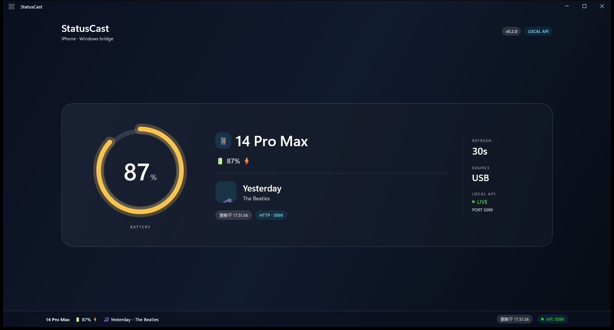
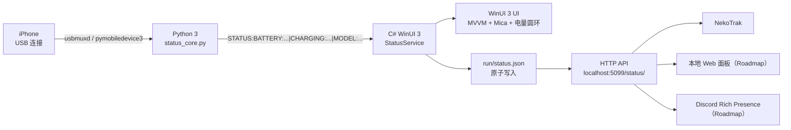

<div align="center">

# StatusCast

**把 iPhone 的电量与状态，广播到 Windows 桌面和第三方展示端。**

[](https://www.microsoft.com/windows)
[](https://www.python.org/)
[](https://dotnet.microsoft.com/)
[](http://localhost:5099/status/)
[](https://github.com/ganmayou2333/StatusCast/releases)
[](LICENSE)

</div>

---

## 项目简介

StatusCast 是一个运行在 Windows 上的 iPhone 状态桥接工具。

它通过 **USB** 读取 iPhone 的电量、充电状态和机型信息，由 **WinUI 3** 桌面应用展示，并对外提供本地 **HTTP API**，供 NekoTrak、未来的 Discord Rich Presence 或其他客户端读取。

核心原则：

- 只有一个数据采集源，避免反复打开 USB 设备；
- UI 与数据采集解耦；
- 第三方展示端只读状态，不直接接触 iPhone。

## 特性亮点

- 🔋 **USB 低成本获取电量**  
  一根数据线即可读取 iPhone 电量、充电状态和机型。

- 🎨 **现代 WinUI 3 界面**  
  MVVM + `x:Bind` + Mica 材质 + 动态电量圆环。

- 🌐 **本地 HTTP API**  
  启动后自动监听 `http://localhost:5099/status/`，返回最新 JSON 状态。

- 🧩 **多端适配**  
  已支持 NekoTrak，结构上为 Discord RPC、Web 面板预留扩展空间。

- 🛡️ **单一数据源**  
  WinUI 3 每 30 秒刷新一次，并原子写入 `run/status.json`；其他消费者读取快照或 API，不重复访问设备。



> 截图使用演示数据；真实数据由 USB 连接的 iPhone 提供。

## 架构图



数据流：

```text
iPhone --USB--> Python 状态采集 --> WinUI 3 单一采集源
                                      ├─ 更新桌面 UI
                                      ├─ 写入 run/status.json
                                      └─ 提供 HTTP API
```

## 快速开始

### 1. 环境要求

| 项目 | 要求 |
| --- | --- |
| 操作系统 | Windows 10 1809+ / Windows 11 |
| Python | Python 3.10+ |
| .NET | .NET 10 SDK（项目当前目标 `net10.0-windows10.0.26100.0`） |
| UI | Windows App SDK 2.5.x（NuGet 自动还原） |
| Apple 驱动 | iTunes 或 Apple Devices，确保 `Apple Mobile Device Service` 正常运行 |
| 设备 | 可传输数据的 USB 线，iPhone 解锁并信任电脑 |

> 如果希望使用 .NET 8，请同时修改 `StatusCast.Gui.csproj` 的 `TargetFramework` 和 SDK 版本；当前仓库以 .NET 10 构建。

### 2. 配置 Python 环境

```powershell
git clone https://github.com/ganmayou2333/StatusCast.git
cd StatusCast

py -3 -m venv .venv
.\.venv\Scripts\python.exe -m pip install --upgrade pip
.\.venv\Scripts\python.exe -m pip install -r requirements.txt
```

验证 Python 采集：

```powershell
.\.venv\Scripts\python.exe status_core.py
```

预期输出：

```text
STATUS:BATTERY:97|CHARGING:true|MEDIA:NA|NA|unknown|MODEL:iPhone14,3
```

### 3. 编译并运行 WinUI 3

```powershell
dotnet build .\gui\StatusCast.Gui\StatusCast.Gui.csproj -c Debug -p:Platform=x64
dotnet run --project .\gui\StatusCast.Gui\StatusCast.Gui.csproj -c Debug -p:Platform=x64
```

也可以使用包装脚本：

```powershell
powershell -NoProfile -ExecutionPolicy Bypass -File .\scripts\run_gui.ps1
```

启动后：

- 主卡片显示机型、电量圆环和状态；
- 底部状态条显示机型、电量、媒体状态和最后更新时间；
- 每 30 秒自动刷新；
- 状态同时写入 `run/status.json`。

## 使用 HTTP API

WinUI 应用启动后，HTTP 服务自动监听：

```text
http://localhost:5099/status/
```

请求示例：

```powershell
Invoke-RestMethod http://localhost:5099/status/ | ConvertTo-Json -Depth 4
```

返回示例：

```json
{
  "schema": 1,
  "battery": {
    "level": 97,
    "isCharging": true,
    "updatedAt": 1792768631,
    "error": null
  },
  "media": {
    "title": null,
    "artist": null,
    "album": null,
    "playbackState": "unknown",
    "durationSeconds": null,
    "elapsedSeconds": null,
    "playerName": null,
    "updatedAt": 1792768631,
    "error": null
  },
  "generatedAt": 1792768631,
  "errors": [],
  "text": "🔋 97% ⚡ | 🎵 暂无播放"
}
```

说明：

- API 仅绑定 `localhost`，不暴露到局域网；
- 返回 `application/json; charset=utf-8`；
- 快照尚未生成时返回 `503`；
- 非 GET 请求返回 `405`；
- 未知路径返回 `404`；
- 端口被占用时应用不会崩溃，底部指示器会显示 `API: 未启动`。

## 纯命令行版本

不启动 WinUI 也可以直接在终端读取状态：

```powershell
.\.venv\Scripts\python.exe cli\statuscast.py
```

输出：

```text
📱 14 Pro Max | 🔋 87% ⚡ | 🎵 暂无播放
```

输出与 HTTP API 相同结构的 JSON：

```powershell
.\.venv\Scripts\python.exe cli\statuscast.py --json
```

每 30 秒刷新一次：

```powershell
.\.venv\Scripts\python.exe cli\statuscast.py --watch 30
```

说明：

- 仅依赖 Python + USB，不需要 WinUI 或 HTTP 服务；
- 没有检测到设备时退出码为 `1`，输出仍会保留友好提示；
- `--watch` 模式会持续运行，按 `Ctrl+C` 停止。

打包单文件 exe：

```powershell
.\scripts\build_cli.ps1
```

输出位于 `dist\statuscast-cli.exe`，可直接分发，不需要目标机器安装 Python。

## NekoTrak 接入

在 NekoTrak 的自定义文本框中填写：

```text
${(Invoke-RestMethod -Uri 'http://localhost:5099/status/' -UseBasicParsing).text}
```

显示效果类似：

```text
📱 13 Pro Max | 🔋 97% ⚡ | 🎵 暂无播放
```

也可以直接调用仓库中的脚本：

```text
{powershell.exe -NoProfile -ExecutionPolicy Bypass -File "G:\StatusCast\integrations\nekotrak\pull.ps1"}
```

使用前请确保 StatusCast WinUI 应用正在运行，否则 API 不可用。

## 项目结构

```text
StatusCast/
├─ status_core.py                 # Python USB 电量/机型采集
├─ cli/statuscast.py              # 纯命令行版本
├─ config.toml
├─ requirements.txt
├─ pyproject.toml
├─ core/                          # Python 核心/数据源
├─ adapters/                      # 适配器骨架
├─ gui/
│  └─ StatusCast.Gui/             # WinUI 3 桌面应用
│     ├─ Services/
│     │  ├─ StatusService.cs      # 调用 Python，写 run/status.json
│     │  └─ StatusServer.cs       # localhost:5099 HTTP API
│     ├─ ViewModels/
│     │  └─ MainViewModel.cs
│     └─ MainWindow.xaml          # 主卡片、电量圆环、状态条
├─ integrations/
│  └─ nekotrak/pull.ps1
├─ scripts/
│  ├─ run_gui.ps1
│  ├─ run_daemon.ps1
│  ├─ install_task.ps1
│  └─ probe_ams.py
├─ tests/
│  ├─ manual/
│  │  ├─ get_battery.py
│  │  └─ get_media.py
│  └─ test_*.py
├─ legacy/
│  └─ get_status.ps1
├─ docs/
│  ├─ ble-ams-notes.md
│  └─ screenshots/                # README 截图
├─ .github/workflows/dotnet.yml
└─ run/                           # 运行时快照（不提交）
```

## 已知问题 / Roadmap

### 已完成

- [x] USB 读取 iPhone 电量、充电状态与机型
- [x] 纯命令行输出（文本 / JSON / watch 模式）
- [x] PowerShell 捕获 Python 输出
- [x] WinUI 3 展示 + MVVM + Mica + 动态电量圆环
- [x] 单一数据源写入 `run/status.json`
- [x] 本地 HTTP 广播服务 `http://localhost:5099/status/`
- [x] NekoTrak 文本接入

### 进行中 / 计划

- [ ] 解决 Realtek 蓝牙适配器的 BLE 配对认证问题  
      当前 AMS 订阅会返回 `Insufficient Authentication`，预计需要更换 Intel 蓝牙网卡后继续验证。
- [ ] 接入 Apple Media Service (AMS)，获取歌名、艺术家与播放状态
- [ ] 开发 Discord Rich Presence 适配器
- [ ] 增加 Web 面板与更多展示端
- [ ] 提供 MSIX 安装包与登录自启选项

## 常见问题

### 检测不到 iPhone

1. 使用支持数据传输的 USB 线；
2. 解锁 iPhone，并在弹窗中点击“信任此电脑”；
3. 确认 `Apple Mobile Device Service` 正在运行；
4. 重新插拔 USB，或重启 Apple 设备服务。

### 页面显示“设备未连接”

先运行：

```powershell
.\.venv\Scripts\python.exe status_core.py
```

确认输出中不是 `BATTERY:NA`。

### HTTP API 启动失败

端口 `5099` 可能被占用。关闭占用端口的程序后重启 WinUI；应用会捕获异常并显示 `API: 未启动`，不会要求管理员权限。

## 版本与发布

- 当前版本：`v0.2.0`
- 发布页：[GitHub Releases](https://github.com/ganmayou2333/StatusCast/releases)
- 变更记录：[CHANGELOG.md](CHANGELOG.md)

## 贡献

欢迎提交 Issue 和 Pull Request。建议先创建 Issue 描述使用场景或问题，再提交改动。详见 [CONTRIBUTING.md](CONTRIBUTING.md)。

## 安全

安全问题请使用 GitHub 私有安全报告，不要直接开公开 Issue。详见 [SECURITY.md](SECURITY.md)。

## License

本项目基于 [MIT License](LICENSE) 开源。

## 致谢

- [pymobiledevice3](https://github.com/doronz88/pymobiledevice3)
- [Windows App SDK / WinUI 3](https://learn.microsoft.com/windows/apps/winui/)
- [bleak](https://github.com/hbldh/bleak)

---

<div align="center">

**StatusCast** · Bridge your iPhone status to Windows.

</div>
